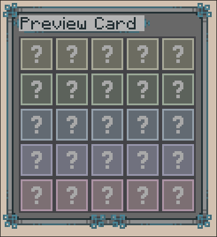

# Game Options

## Modes

Bingo's modes affect how scored items behave on the card. Multiple modes can be enabled at once; or you can leave them
all off for the default behavior.

### Lockout

Once an item is collected by any team, that tile is locked and no other teams can collect it.

This works best if "goal" is set to a # of items, rather than lines. If the goal becomes impossible for any team to accomplish, the game will immediately end.

### Inventory

Items must remain in a team member's inventory to hold a tile. Losing an item un-marks its tile on the card (meaning you need to stay alive with your items in order to win).

::: tip

The [PlayerTracker](https://modrinth.com/mod/playertracker) mod works well with lockout + inventory to make this
more of a PvP-focused mode.

:::

### Ranked

The game does not end when a team wins. Instead, it keeps going until the time limit and lists the winners when it ends.

This is intended for competitions/tournaments where you want every team to have a placement, rather than immediately
ending the game when a single winner is determined.

This mode [is subject to change](https://gitlab.com/horrific-tweaks/bingo/-/issues/73) in a future version.

### Hidden Items

Items are not shown on the bingo card until a player discovers them.

For advancement/challenge goals, the item will be shown as soon as any amount of progress is made.

It's a mystery! Good luck crafting every variant of wooden fence \:)

## Item Distribution

The "item distribution" decides how many items will be pulled from each tier to make the card.
These values must add up to 25 or less.

Each bingo card will be generated by randomly selecting the number of items from each tier.

This means that, although the items on the card are randomized, the difficulty will remain relatively the same according to the item distribution that you pick.

These are typically organized by the following:

- **D-tier:** Items that you can immediately pick up in the world, with little to no exploring/preparation.
- **C-tier:** Might take some preparation (collecting iron, building a nether portal), but can be obtained in 10-20 minutes on most attempts.
- **B-tier:** Involves moderate preparation or finding a specific biome/structure to obtain. This includes items from lush caves or particular nether biomes.
- **A-tier:** Items with high difficulty, but are still usually obtainable within a 1hr time limit. This includes items from Bastions, Ancient Cities, some rare biomes (desert/mangrove), and time-consuming tasks (beekeeping).
- **S-tier:** For any of these items, you need to literally speedrun the game and then some. Includes outer end items, netherite gear, silk touch blocks, and general endgame items.
