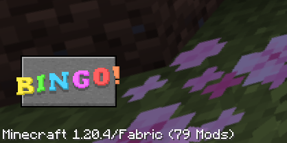

# Getting Started

To use this mod, you'll first need to have [Quilt](https://quiltmc.org/en/) or [Fabric](https://fabricmc.net) installed.

::: tip
If you're just running this mod in singleplayer and are new to Minecraft mods, I recommend using the [Modrinth Launcher](https://modrinth.com/app).

It's very user-friendly, and you can install the mod from it just by clicking the "Install" button, without dragging any files around!
:::

Once those are set up, you'll likely need to open the game once for it to create its game folder.

> If you're using the Mojang-provided launcher, your Minecraft folder will be in the following location:
> - **Windows:** Press Win+R, type `%appdata%\.minecraft`, then press Ok.
> - **MacOS:** Open Finder then paste `~/Library/Application Support/minecraft` in the Search box.
> - **Linux:** `~/.minecraft`, or `/home/USER/.minecraft` 
>   (in most file managers, look for a "Show Hidden Files" option if it doesn't show up)
>
> If you're using a different launcher, this is likely in a completely different location. Find the help page for your launcher or look for a "Minecraft Folder" or "Game Dir" setting.

## Installing mods

Next, you'll need to download the following mod files and place them in the Minecraft "mods/" folder.

- [Fabric API](https://modrinth.com/mod/fabric-api)
- [Yet Another Minecraft BINGO](https://modrinth.com/mod/yet-another-minecraft-bingo)

::: warning
Make sure that the versions you download match your Minecraft version!

For example, if you're running Minecraft 1.20.4, you'll need to use the `fabric-api-*+1.20.4.jar` and `bingo-*-mc1.20.4.jar` versions.
:::

This mod aims to be compatible with most other Quilt or Fabric mods and datapacks, provided they don't directly interfere with its behavior. If something doesn't work as expected, feel free to [report an issue](https://gitlab.com/horrific-tweaks/bingo/-/issues) or let me know [on Discord](https://discord.horrific.dev/)!

Check out [Server Optimization](./optimization#optimization-mods) for a list of additional mods I recommend installing for performance.

## Starting a game

If you've installed the mod on the client, you should see a "BINGO!" button in the bottom right of the Minecraft title screen. Clicking this will launch directly into a bingo world.

If you leave the world mid-game, it should show up as a singleplayer world entry. However, any save files will be automatically removed once the game is completed.

To start a new game, you'll need to close the world and click the "BINGO!" button again.

If you're running the game on a server, you'll need to **restart the server** after each game (using the `/stop` or `/restart` commands).
