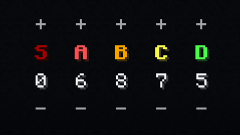

# Item Distribution

The "item distribution" can be configured in-game to change how many items will be pulled from each tier to make the
card. These values must add up to 25.

## Item Groups

In the "Item Groups" tab in the tier list editor, dragging multiple items into each other will create an item group:

    <ItemGroup name="pointed_dripstone|dripstone_block" />

When generating a card, only one item from each group can be chosen at a time. This means that, with a group of e.g.
"pointed dripstone" and "dripstone block", you will never see a card contain both items at once.
