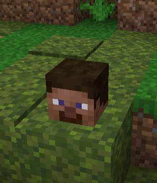
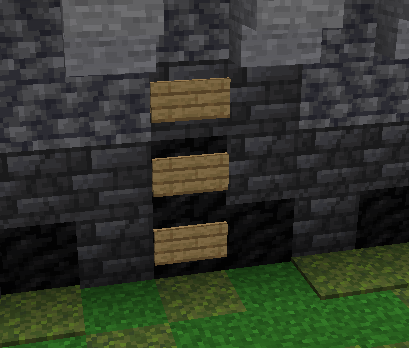
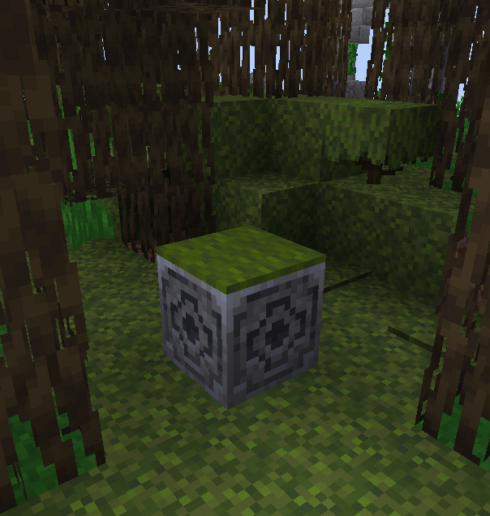

# Customizing the lobby

The lobby used as the game's spawn area can be changed by adding a `lobby_world.zip` file to the mod's config folder.

To start, it is recommended that you download the [default lobby_world.zip](https://gitlab.com/horrific-tweaks/bingo/-/blob/main/common/src/main/resources/yet-another-minecraft-bingo/lobby_world.zip?ref_type=heads)
and extract it into your Minecraft `saves/` folder. This should make the lobby show up as a creative world
in your singleplayer world list.

Once you've made your changes, you can export it for the bingo mod by either re-zipping the world save or
using "Edit > Make Backup" from the world list, which will place a zip in your `backups/` folder.

You can then place the resulting zip into `./config/yet-another-minecraft-bingo/lobby_world.zip`, and
the server will use it in place of the default lobby.

```txt{5}
🗀 config/
 └ 🗀 yet-another-minecraft-bingo/
   ├ 🗀 images/
   ├ config.json
   ├ lobby_world.zip
   └ player-settings.json
🗀 mods/
🗀 world/
server.properties
```

## Lobby Behavior

When the server starts up, it looks for specific blocks in a 48x48 box around the world origin to use for
specific functionality...

<div class="figure-wrap">
<figure>

### Spawnpoint

The world spawn can be changed by placing a `minecraft:player_head` at the location you want players to spawn
in the lobby.

</figure>
<figure>



</figure>
</div>

<div class="figure-wrap">
<figure>

### Game Menu

The game menu looks for three vertical `minecraft:oak_wall_sign` (an oak sign placed against a wall) blocks
to set its position. It has a total height of 4 blocks and a width of 14.

</figure>
<figure>



</figure>
</div>

<div class="figure-wrap">
<figure>

### Team Pickers

The "team picker" entities can be created by placing a colored carpet on top of a lodestone block.

</figure>
<figure>



</figure>
</div>

This only works for the set teams included in the mod; i.e.
- Blue Team (`minecraft:blue_carpet`)
- Red Team (`minecraft:red_carpet`)
- Green Team (`minecraft:green_carpet`)
- Yellow Team (`minecraft:yellow_carpet`)
- Pink Team (`minecraft:pink_carpet`)
- Aqua Team (`minecraft:cyan_carpet`)
- Orange Team (`minecraft:orange_carpet`)
- Gray Team (`minecraft:light_gray_carpet`)

### Stats

The statistics menu will activate whenever a player walks over an iron pressure plate. It will look for
the nearest armor stand entity and spawn its other display entities around it.
