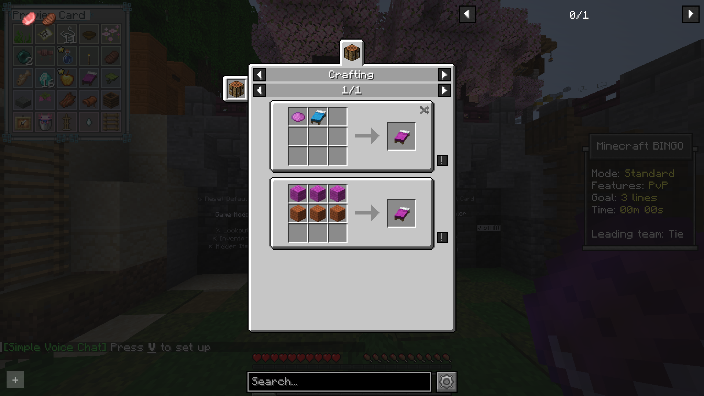

The bingo UI includes compatibility with several mods that implement similar behavior to index crafting recipes:
- [Just Enough Items](https://modrinth.com/mod/jei)
- [Roughly Enough Items](https://modrinth.com/mod/rei)
- [Emi Memy Imi](https://modrinth.com/mod/emi)

::: warning Note:
On 1.21.2+, these mods likely also require server-side installation to function correctly.
:::

With these installed, you can open the bingo card with <kbd>Y</kbd> and click on any craftable item to see its recipes.

