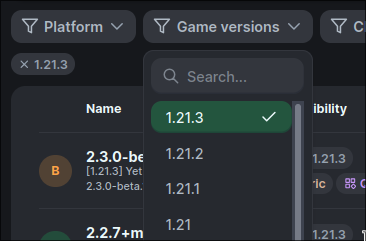

# Server Setup

## Where to find server hosting

There are many Minecraft server hosts to choose from! I recommend searching around to compare your options.

Here are a few things to keep in mind:

- Look for sites with "Fabric" or "Quilt" hosting options - those are the mod loaders that Yet Another Bingo is compatible with.
- Don't use Realms. [Minecraft Realms does not support mods.](https://gaming.stackexchange.com/questions/399537/can-i-use-mods-on-realms-for-minecraft-java-edition)
- Avoid "free hosting" sites. These are usually either a scam, or extremely limited in performance, and don't provide a great experience with this mod.

## Installing the mod

Once you've found a server host, you'll want to find their help page for installing mods. For example, [here is Shockbyte's article](https://shockbyte.com/help/knowledgebase/articles/how-to-install-fabric-mods-on-your-minecraft-server).

At minimum, you'll need to install [fabric-api](https://modrinth.com/mod/fabric-api) and [bingo](https://modrinth.com/mod/yet-another-minecraft-bingo). I also recommend [lithium](https://modrinth.com/mod/lithium), [servercore](https://modrinth.com/mod/servercore), and [c2me](https://modrinth.com/mod/c2me-fabric) if lag is a concern (see: [Server Optimization](./optimization)).

Make sure to get the jar files for the same Minecraft version as your server! If your server is "1.21.3", a jar file for "1.20.3" probably won't work. Use Modrinth's "Game Versions" dropdown to make sure you select the right one!

## Enable "lobby mode"

When the mod is installed on a dedicated server, it can be used in two "modes":

<table>
<thead>
<tr>
<th>SMP Mode (Default)</th>
<th>Lobby Mode</th>
</tr>
</thead>
<tbody>
<tr>
<td>

- Behaves like a survival server
- Does not teleport players, clear inventory, or change gamemode
- Has limited game options
- Does not erase any world data

</td>
<td>

- Erases the world on every launch
- Starts players in a pre-game lobby structure
- Teleports teams into the world with an empty inventory

</td>
</tr>
</tbody>
</table>

### SMP Mode

**SMP Mode** is the default because it involves minimal changes to the game and will not erase any player data.

This means that the mod can be installed on an SMP to run a game as a server event.

There is no "pre-game lobby" in this mode. Instead, you can configure and start the game using the `/bingo` commands.

This will not interfere with other players on the server, and is heavily limited in functionality to avoid any game-breaking behavior.

::: warning
**Please take regular backups if you care about your world!**

This mode has been tested to ensure that world files and player inventory are kept safe, but computers are quite complicated so I can't make any guarantees.

There is no way to recover your world data if it is deleted by this mod.
:::

### Lobby Mode

On the other hand, **Lobby Mode** is intended for servers that will *only* run BINGO games. This mode **resets the entire world after each game!**

In Lobby Mode, the mod will start players in the BINGO lobby and teleport them to random locations when the game is started.

To enable Lobby mode:
- Run the `/bingo lobby` command. This will warn you about the world deletion behavior.
- Acknowledge the warnings with `/bingo lobby confirm`.
- Wait for the server to restart.

