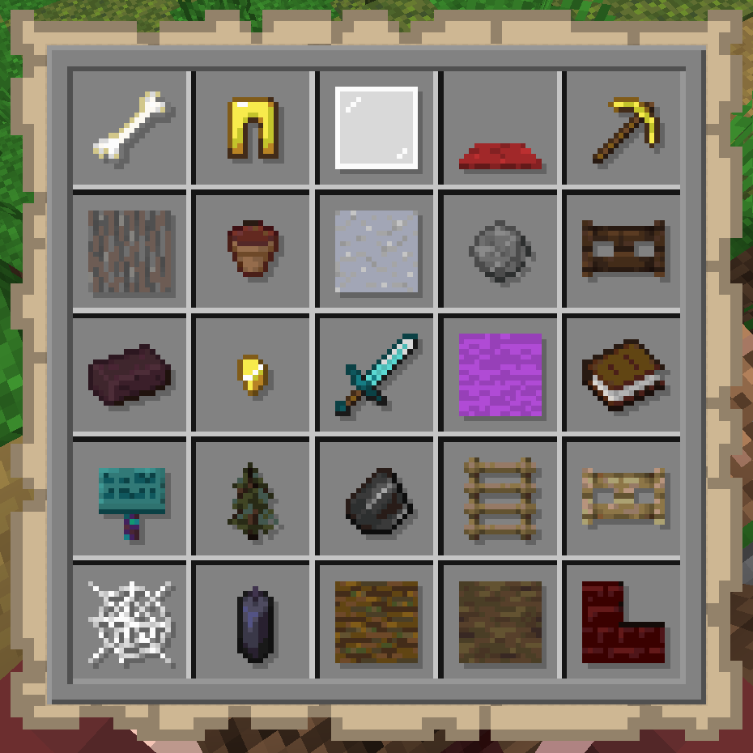
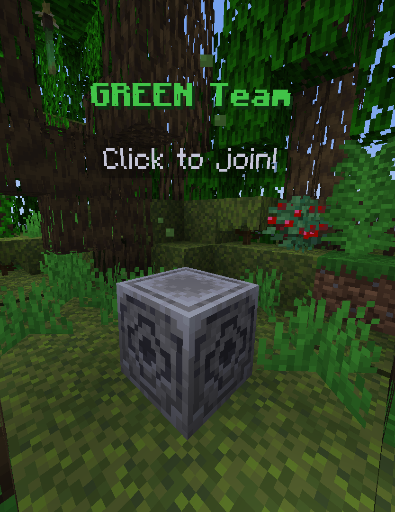
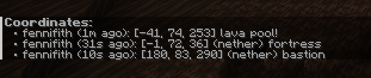

# What is Minecraft BINGO?

"Minecraft BINGO" is a custom gamemode in which teams compete to collect the items on a randomized Bingo Card.

<figure>

</figure>
<figure>

- Each team receives the same random Bingo Card at the start of the game.
- Teams are teleported to a random location in the world.
- The first team to complete the required number of lines (row, column, or diagonal) wins the game!

</figure>

::: tip
🖱️ Right-click when holding the map to see the items in an inventory view!
:::

The game can be started with a timer to limit the duration of the game.

If the timer runs out, the team that is closest to winning the game is declared as the winner!

> This is decided in the order of:
>
> 1. The team that has the most *completed lines*
> 2. The team that has captured the most *individual items*
>
> In other words, if "Green Team" has captured two lines with 9 items, and "Orange Team" has captured one line with 11 items, then "Green Team" is declared as the winner.

## Joining a team

<figure>

Before the game starts, everyone will be in a small pre-game lobby map where the bingo options can be configured.

Players can find various "team markers" around this lobby to join a team, or use the `/join <team>` command.

Operators can also shuffle teams or assign a player to a specific team using `/join <team> <player>`.

</figure>
<figure>

</figure>

## Chat messages

During the game, players can use the chat to communicate with their team. Chat messages are only sent to the current team by default - players can use `/all` or `/g` to send a message to all players on the server.

Players can also use the `/coords` command to share their current coordinates, and `/coords list` will show a list of the recent coordinates recorded by the team.

## After the game...

Once the game ends, players will be given the bingo cards of every team to see what items they captured.

